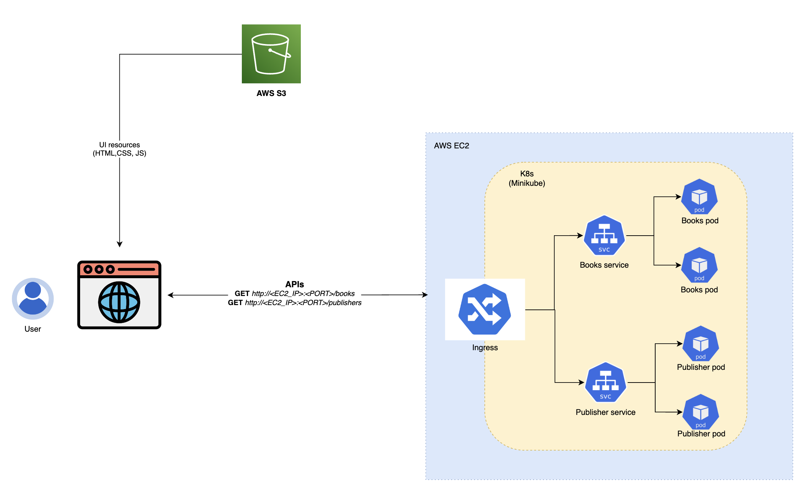

# Journey of a Click 🚀

[](https://opensource.org/licenses/MIT)
[](https://www.docker.com/)
[](https://kubernetes.io/)

A simple but complete full stack project showcasing **complete end-to-end development and deployment** of a microservices-based application using modern DevOps practices.

## 🎯 Project Overview

This project demonstrates a full-stack microservices architecture deployed on Kubernetes in AWS, featuring:

- **Frontend**: React TypeScript application with Grommet UI
- **Backend Services**: 
  - Books Service (Node.js/Express)
  - Publishers Service (Python/FastAPI)
- **Containerization**: Docker containers for all services
- **Orchestration**: Kubernetes deployment along with complete K8s manifests with ingress configuration
- **Infrastructure**: AWS EC2, AWS S3 and Minikube

## 🏗️ Architecture



## 🚀 Quick Start

### Prerequisites

Before you begin, ensure you have the following installed:

1. **Minikube or Kubernetes cluster**
   - [Installation Guide](https://minikube.sigs.k8s.io/docs/start/)
2. **Docker**
   - [Installation Guide](https://docs.docker.com/engine/install/)
3. **Node.js Runtime (v16+)**
   - [Installation Guide](https://nodejs.org/en/download)

### 🐳 Deployment Steps

#### 1. Start Minikube

```bash
minikube start
```

**Common Issues & Solutions:**
```bash
# Fix Docker permissions if minikube can't reach Docker daemon
sudo chmod 666 /var/run/docker.sock

# Set kubectl alias for minikube
alias kubectl="minikube kubectl --"

# Start nginx if required
sudo systemctl start nginx

# Fix JUJU_PERMISSION file error if encountered
sudo sysctl fs.protected_regular=0
```

#### 2. Deploy Backend Microservices

```bash
# Deploy Books Service
kubectl apply -f books-service/deployment-files/books-deployment.yaml
kubectl apply -f books-service/deployment-files/books-service.yaml

# Deploy Publishers Service
kubectl apply -f publishers-service/deployment-files/publisher-deployment.yaml
kubectl apply -f publishers-service/deployment-files/publisher-service.yaml
```

#### 3. Configure Ingress

```bash
# Enable ingress addon if not already enabled
minikube addons enable ingress

# Apply ingress configuration
kubectl apply -f books-service/deployment-files/ingress.yaml
```

#### 4. Start the Frontend Application

```bash
cd ui-app
npm install
npm start
```

The application will be available at:
- **Frontend**: http://localhost:3000
- **Books API**: http://oneclick.k8s.io/books
- **Publishers API**: http://oneclick.k8s.io/publishers

## 📁 Project Structure

```
journey-of-oneclick/
├── README.md                          # Main project documentation
├── books-service/                     # Node.js Express API
│   ├── Dockerfile                     # Container configuration
│   ├── index.js                       # Express server
│   ├── package.json                   # Dependencies
│   └── deployment-files/              # Kubernetes manifests
├── publishers-service/                # Python FastAPI service
│   ├── Dockerfile                     # Container configuration
│   ├── requirements.txt               # Python dependencies
│   ├── app/main.py                    # FastAPI application
│   └── deployment-files/              # Kubernetes manifests
└── ui-app/                           # React TypeScript frontend
    ├── src/                          # Source code
    ├── public/                       # Static assets
    └── package.json                  # Dependencies
```

## 🛠️ Development

### Local Development Setup

1. **Books Service (Node.js)**
   ```bash
   cd books-service
   npm install
   npm start
   ```

2. **Publishers Service (Python)**
   ```bash
   cd publishers-service
   pip install -r requirements.txt
   uvicorn app.main:app --reload --host 0.0.0.0 --port 80
   ```

3. **UI Application (React)**
   ```bash
   cd ui-app
   npm install
   npm start
   ```

## 🐋 Docker Images

Pre-built Docker images are available on Docker Hub:

- **Books Service**: `sagardev/books:1.0`
- **Publishers Service**: `sagardev/publishers:1.0`

### Building Custom Images

```bash
# Books Service
cd books-service
docker build -t your-registry/books:1.0 .
docker push your-registry/books:1.0

# Publishers Service
cd publishers-service
docker build -t your-registry/publishers:1.0 .
docker push your-registry/publishers:1.0
```

## 🔍 API Endpoints

### Books Service
- **GET** `/books` - Returns top 10 most popular books
- **Response**: JSON with book details and metadata

### Publishers Service
- **GET** `/publishers` - Returns top 10 largest publishing companies
- **Response**: JSON with publisher details and revenue information

## 🤝 Contributing

Contributions are welcome! Please feel free to submit a Pull Request. For major changes, please open an issue first to discuss what you would like to change.

1. Fork the Project
2. Create your Feature Branch (`git checkout -b feature/AmazingFeature`)
3. Commit your Changes (`git commit -m 'Add some AmazingFeature'`)
4. Push to the Branch (`git push origin feature/AmazingFeature`)
5. Open a Pull Request

## 📋 Features Demonstrated

- ✅ **Microservices Architecture**
- ✅ **Containerization with Docker**
- ✅ **Kubernetes Orchestration**
- ✅ **Service Discovery & Load Balancing**
- ✅ **Ingress Configuration**
- ✅ **Multi-language Backend Services**
- ✅ **Modern React Frontend**
- ✅ **CI/CD Ready Structure**

## 📄 License

This project is licensed under the MIT License - see the [LICENSE](LICENSE) file for details.

## 🌟 Support

If you find this project helpful, please consider giving it a ⭐ on GitHub!

## 📞 Feedback

Have questions or suggestions? [Provide Feedback](https://forms.gle/XW8PLFjzEEg2JPKj9)


